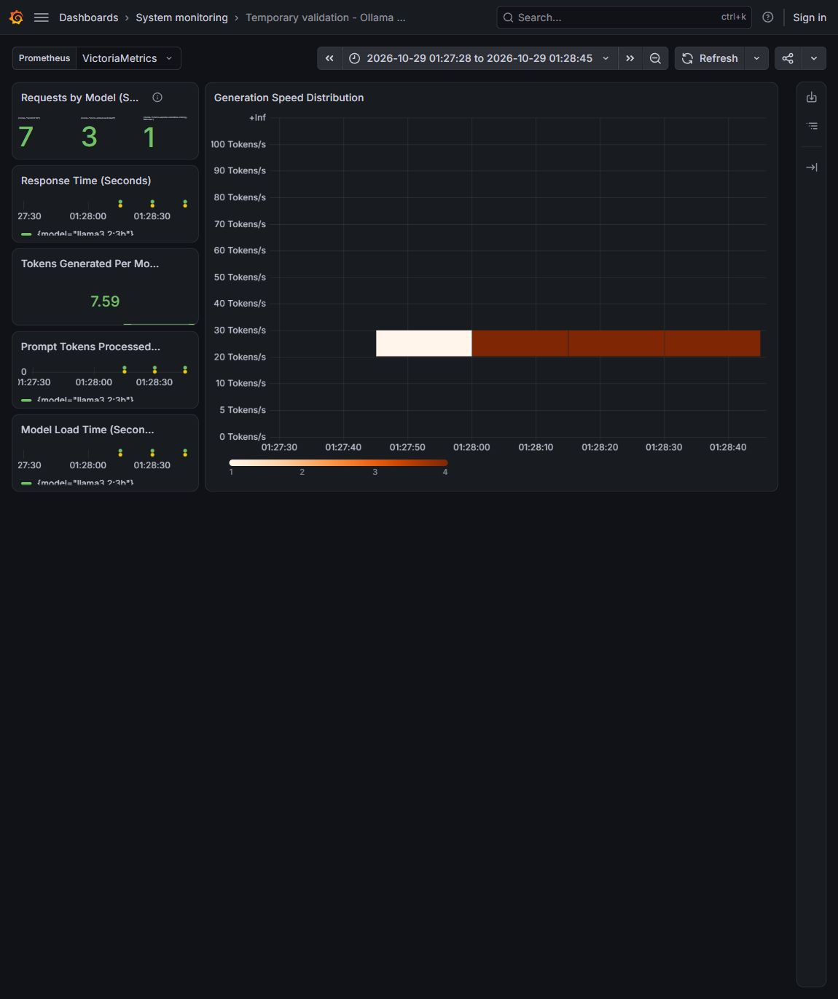
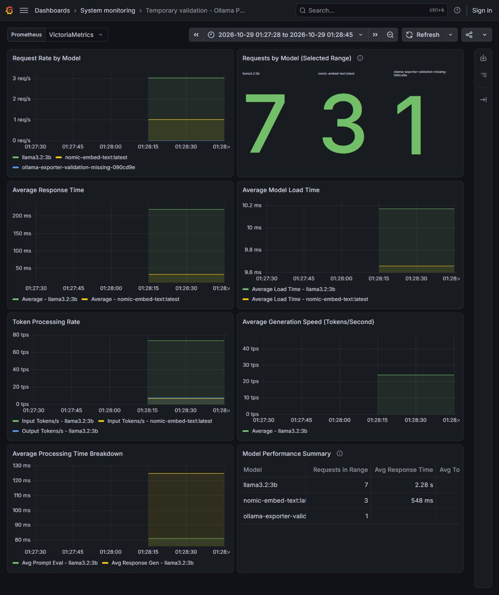

# Live validation: 2026-10-29

Validated main commit `090cd9ef519c31c7af0a6ad0f23e87a66e9a2927` with real
Ollama requests and a Grafana/VictoriaMetrics monitoring stack. All recorded
checks passed. This record covers smoke and integration acceptance for the
versions and models below.

This dated record updates the validation status previously described in
[PR #16](https://github.com/frcooper/ollama-exporter/pull/16) and
[PR #17](https://github.com/frcooper/ollama-exporter/pull/17). Their merged PR
descriptions remain historical records of the checks available at that time.

## Environment

| Component | Tested configuration |
| --- | --- |
| Native exporter | Windows, Python 3.12.9 |
| Container exporter | Repository Dockerfile, Python 3.11 base, WSLC 3.0.4 |
| Container permissions | UID 10001; existing CLI entrypoint and dual-stack listener |
| Ollama | 0.35.1 |
| Generation model | Existing `llama3.2:3b` |
| Embedding model | Existing `nomic-embed-text:latest` |
| Grafana | 13.2.4 |
| Data source | Existing Prometheus-compatible VictoriaMetrics data source |

Synthetic prompts and existing models were used. No models or container images
were published.

## Automated and live application checks

The automated suite passed all 57 tests, and `python -m pip check` reported no
broken requirements. The live checks were a separate run against real services.

All 16 live checks passed:

| Check | Observed result |
| --- | --- |
| Native Windows CLI and pass-through | Started successfully; Ollama version and text metrics returned |
| Non-streaming native generation | Completed with response and prompt token counts |
| Batch embeddings | Two 768-dimensional vectors and input-token statistics returned |
| Streaming native chat | Multiple records followed by a completed final record |
| Default streaming generation | Streaming worked with `stream` omitted |
| OpenAI chat, non-streaming | Response and usage statistics returned |
| OpenAI chat, streaming | Usage record and final `[DONE]` event returned |
| Legacy embeddings | Embedding vector returned; request counted without inventing missing token statistics |
| Missing upstream model | Ollama's 404 and error body preserved |
| Stream cancellation | Closing the client stream returned the in-flight gauge to zero |
| Repeated generation | Completed successfully and advanced the metrics |
| Repeated batch embeddings | Completed successfully and advanced the metrics |
| Metrics scrape | Expected request, token, and duration metrics present; idle in-flight gauges zero |
| OpenAI classic completions, non-streaming | Response and usage statistics returned |
| OpenAI classic completions, streaming | Usage record and final `[DONE]` event returned |
| Total inference deadline | A temporary 50 ms deadline returned 504 against real Ollama; in-flight gauge returned to zero |

The existing TCP integration tests also verify that disconnects close the
upstream connection, including before response headers arrive.

## Grafana acceptance

All 18 query targets across `dashboard.json` and `dashboard_custom.json`
returned non-empty results with finite numeric values through Grafana's
existing VictoriaMetrics data source.

Three snapshots of actual exporter metrics were ingested under a unique test
label. Temporary copies of the two dashboards used unique UIDs, a filter for
that label, and a fixed test interval. The copies retained the shipped data-source
variable and panel definitions. They were loaded through an existing file
provider and viewed anonymously, without changing Grafana authentication or
restarting the service.

Visual inspection confirmed:

- The data-source selector automatically selected VictoriaMetrics.
- All six overview panels and all eight performance panels displayed data.
- Request totals and the model summary table matched the captured test metrics.
- Generation speed, duration, token-rate, and heatmap panels rendered.
- The browser reported no errors.

### Overview dashboard

### Performance dashboard

## Cleanup and outcome

Both temporary dashboard files were removed. Grafana subsequently returned
404 for their UIDs. Only the uniquely labelled test metric series were deleted,
and a fresh query confirmed none remained.

The native test process, both temporary containers, and the validation image
were removed. Test models were unloaded, restoring the initial loaded-model
state. Existing services, dashboards, provisioning settings, and the repository's
runtime files were unchanged.

The tested main commit passed this acceptance run for an initial source-only
release. No release or version tag was created by the validation or this
documentation update.
